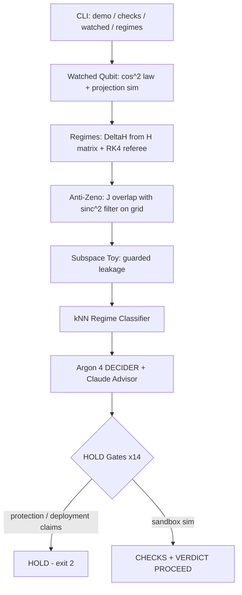
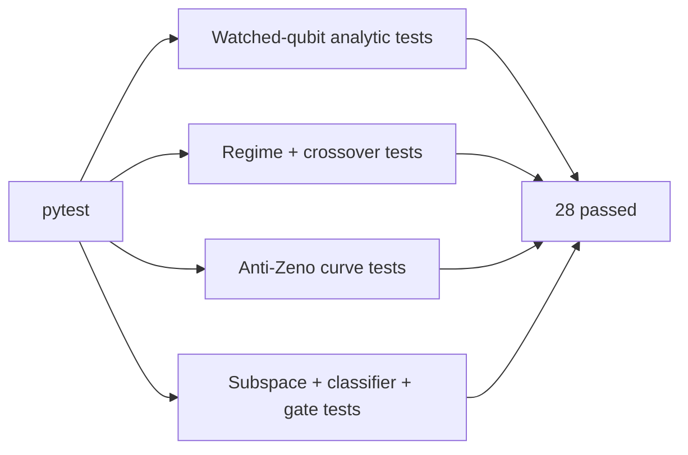
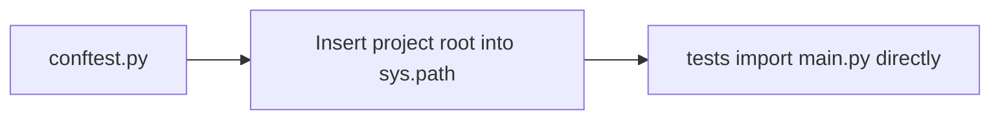
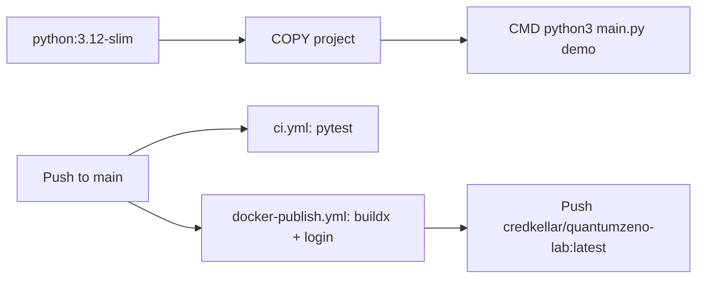

# QuantumZeno-Lab ⏱️⚛️

**Quantum Zeno & Anti-Zeno Effect Lab** — by Darion Kellar

QuantumZeno-Lab is an **educational quantum Zeno and anti-Zeno lab** in ONE pure-Python file. It builds the watched-pot effect from the ground up, with every headline number computed from scratch and graded against the closed form it comes from:

- **The watched qubit** — a resonantly driven two-level system that would Rabi-flop all the way over at t = π instead stays put under ideal projective measurements: survival climbs 0 → 0.25 → 0.605429 → 0.780546 → 0.951842 → 0.975627 → **0.997536** as the measurement count runs N = 1, 2, 5, 10, 50, 100, 1000. ❄️
- **The reason it works** — decay does not start exponentially. Short-time survival is **quadratic**, P(t) ≈ 1 − (t/τ_Z)², with τ_Z from ΔH computed out of a labelled model Hamiltonian's matrix — so each frequent check only ever throws away a tiny squared sliver. 📐
- **The twist** — measure at the wrong rate into the wrong reservoir and the trick runs backwards: the decay rate rises **1.21× above the free rate** (anti-Zeno) before falling to zero as the interval shrinks. 🔄
- **The guard duty version** — a three-level leakage toy where projective checks protect a computational subspace, cutting the leaked population **74.0×** at 100 checks. 🛡️

Honest scope, stated up front: every measurement here is **ideal and projective** — no detector inefficiency, dark count, or readout error is modelled, and none may be claimed. All parameters are **labelled teaching numbers**. This lab protects **nothing real**: no qubit, no memory, no decay. Every protection / deployment / product claim sits behind a permanent HOLD gate (14 total). 🔒

[](https://github.com/kimanicollier44-cmyk/QuantumZeno-Lab/actions/workflows/ci.yml)
[](https://github.com/kimanicollier44-cmyk/QuantumZeno-Lab/actions/workflows/docker-publish.yml)

> ℹ️ These are the **live** workflow badges for this repo. They activate as soon as the `ci.yml` and `docker-publish.yml` files from the paste pack are pasted into `.github/workflows/` — until then they have nothing to report yet.

## 🧰 Tech Stack Badges & Full Architecture Tech Stack

### 💻 Core Programming Languages & Core Systems


- 🐍 Python 3.12, pure standard library (`math`, `cmath`, `hashlib`, `json`, `sys`) — zero dependencies, zero network, deterministic (double-run byte-identical)
- ⏱️ Zeno core from scratch: the exact watched-survival law `[cos²(Ωt/2N)]^N` graded against an independent step-by-step evolve-project-renormalise simulation, ΔH read off the model Hamiltonian's matrix entries (⟨H²⟩ − ⟨H⟩²), the reservoir rate integrated numerically on a stated trapezoid grid (ω ∈ [0, 70], step 0.025), and both crossings (quadratic/exponential, Zeno/anti-Zeno) located by bisection on the computed curves — every headline number asserted against its analytic value in CHECKS
- 🧠 TinyML kNN regime classifier (from scratch, stdlib, distance-weighted): zeno-frozen / free-evolution / anti-zeno-accelerated / exponential-decay from survival + rate ratio + measurement count, labels from the lab's own policy
- 🪑 Council seats: Gemini Argon 4 DECIDER (names-only, tighten-only) + Muse advisor (never overrides HOLD) + Google Flow plan-only (rendered = False, live = 0)

### ⛓️ Web3 & Infrastructure

- 🚫 **Not applicable — honestly.** No blockchain, no Web3, no tokens: the "infrastructure" in this lab is one offline file holding a Rabi drive, a Lorentzian reservoir, and a leakage toy. Real error-correction deployment is a permanent HOLD gate, not a feature. No fake badges here.

### ⚙️ Platform Support & Hardware Architecture


- 🖥️ Pure Python — runs anywhere Python 3.12+ runs (Linux, macOS, Windows), plus the `python:3.12-slim` Docker image
- 🔒 No hardware is controlled, ever: real qubits, detectors, and measurement electronics are permanent HOLD gates (see the gate table below)

### ⚡ Low-Level Infrastructure & Performance

- 🚫 **No low-level code — honestly.** No C, no C++, no GPU, no compiled extensions: this is one interpreted Python file on purpose, so every probability can be read, checked, and diffed. Performance here means honest algorithms — a 2,801-point reservoir grid reused across every rate evaluation, RK4 propagators that referee the closed forms, and 200-step bisections for the crossings — all deterministic and byte-identical between runs.

### 🛠️ DevOps & Build Tools


- 🐳 Docker (`python:3.12-slim`), GitHub Actions CI + Docker Publish (delivered in the paste pack)
- 🎯 Target image: `credkellar/quantumzeno-lab:latest`
- 🧪 Tests: `pytest` (28 tests) + the built-in CHECKS suite (52 checks) in `main.py`

### ☁️ Cloud Providers

- 🚫 **None — honestly.** No cloud provider is used or needed: the lab runs fully offline on your own machine or in a local Docker container. Docker Hub appears only as the registry the publish workflow pushes the image to.

## What this does?

1. 🍲 **The watched pot** — a resonantly driven qubit (Ω = 1, labelled) under N ideal projective measurements spread over t = π: unwatched it flips completely (P = 0), but survival climbs with N — 0.25 at N = 2, 0.605429 at N = 5, 0.951842 at N = 50, **0.997536 at N = 1000** — computed two independent ways (closed form and step-by-step projection simulation) that must agree to 1e-12.
2. 📉 **The deficit law** — the missing probability falls as 1 − P_N ≈ (Ωt)²/(4N): at N = 1000 the asymptotic estimate 2.467401e-03 sits within **0.12%** of the exact deficit 2.464361e-03, and CHECKS asserts the relative error shrinks monotonically from N = 10 to N = 1000. The 1/N tail *is* the Zeno effect, priced.
3. 📐 **ΔH from the matrix, not from a quote** — the labelled model Hamiltonian H = (0.7/2)σ_z + (1.0/2)σ_x gives ΔH = **0.500000** computed from ⟨H²⟩ − ⟨H⟩² over its entries, so τ_Z = 1/ΔH = **2.000000**. The exact survival under that H is integrated independently by RK4 and matches the closed form.
4. ⚖️ **Quadratic vs exponential, refereed** — at t = 0.2 the exact survival 0.990050 hugs the quadratic law (0.990000) and ignores the exponential (0.969699); by t = τ_Z the quadratic has plunged to 0 while the exact curve is still at 0.407832. The quadratic law breaks (>1% error) at **t = 0.758779**, and the two asymptotes cross at **t = 0.588355** — both located by bisection on the computed curves.
5. 🌊 **The reservoir** — a Lorentzian spectral density J(ω) centred at ω₀ = 9.0 with width λ = 1.0, and the transition parked on its slope at ω_a = 10.5. The free golden-rule rate Γ(∞) = 2πJ(ω_a) = **0.153846** is analytic; everything else is integrated.
6. 🔄 **The anti-Zeno curve** — Γ(τ) is the overlap of J with the measurement-broadened sinc² filter, integrated on the stated grid: ratio 0.0776 at τ = 0.05 (deep Zeno suppression), crossing 1 at **τ\* = 0.9317**, peaking at **1.2103 near τ = 1.91**, then relaxing back toward the free rate (1.0192 at τ = 20). Watching at the wrong rate makes decay *faster* — computed, not asserted.
7. 🛡️ **The subspace guard** — a three-level toy (g = 0.3 coupling |1⟩ to the leakage state |2⟩): unguarded, 0.654508 of the population leaks over t = π. Projective checks keep [cos²(gτ)]^M in the subspace — leaked population falls 0.369734 → 0.163656 → 0.085116 → 0.043457 → 0.017609 → **0.008843** for 2, 5, 10, 20, 50, 100 checks, a **74.0× suppression**, with each interval's leak verified quadratic in (gτ).
8. 🏷️ **Regime classifier + seats + checks** — a from-scratch distance-weighted kNN labels operating points zeno-frozen / free-evolution / anti-zeno-accelerated / exponential-decay (the τ = 2 anti-Zeno peak is classified anti-zeno-accelerated from the lab's own computed ratio), with Argon 4 DECIDER (sha256 trace), Muse advisor, Google Flow plan-only, and a built-in CHECKS suite (52 checks).

## 🗺️ How it works — diagram per script

### `main.py` — the whole lab



### `tests/test_main.py` — verification



### `conftest.py` — test path setup



### `Dockerfile` + CI flow — container & publish



## Why is this cool?

1. 🍲 The watched pot, with a receipt: one line of trigonometry — `[cos²(Ωt/2N)]^N` — turns a guaranteed flip (P = 0) into a 0.997536 survival at N = 1000, and the lab proves the formula against a step-by-step simulation instead of asking you to trust it.
2. 📉 The deficit has a law: 1 − P_N ≈ (Ωt)²/(4N) is *derived* in the docstring from ln cos² and then verified numerically to 0.12% — the 1/N tail is the whole effect in one fraction.
3. 📐 τ_Z is computed, not quoted: ΔH comes out of the Hamiltonian's own matrix entries, so the Zeno time is a consequence of the model, not a number pasted from a textbook.
4. ⚖️ The two regimes are refereed against each other: exact curve, quadratic law, and exponential law printed side by side, with the breakdown time (0.758779) and crossover time (0.588355) found by bisection — you can watch the exponential *fail* at short times, which is precisely why Zeno works.
5. 🔄 Anti-Zeno is not a footnote: the rate curve is integrated point by point and it genuinely crests **21% above the free rate** — the same measurement trick, run at the wrong tempo, accelerates decay. Both directions of the effect live in one table.
6. 🎯 The crossing τ\* = 0.9317 is a design number: below it measurements protect, above it they hurt (until the curve relaxes). It falls out of a bisection on the computed curve, not out of a rule of thumb.
7. 🛡️ The subspace toy shows *why* real error correction borrows this trick: per-interval leakage is quadratic, (gτ)², so splitting the same total time into 100 guarded intervals buys a 74.0× suppression — the arithmetic behind syndrome measurement, honestly labelled as a toy.
8. 🌊 The reservoir is integrated, not sketched: a stated 2,801-point trapezoid grid, a sinc² filter, and tolerances in CHECKS that respect the grid's own truncation — the numerics confess their limits.
9. 🏷️ The classifier reads the physics back: feed it the computed survival, rate ratio, and count at the anti-Zeno peak and it says anti-zeno-accelerated; feed it the frozen flip and it says zeno-frozen — and CHECKS asserts it agrees with the lab's policy on all 891 grid points.
10. 🎯 Deterministic end to end: run it twice, get byte-identical output — a Zeno lab you can diff.

## What problems this solves?

1. ❌ **Problem:** "A watched pot never boils" is taught as a slogan with no numbers attached. ✅ **Solution:** The full survival ladder at the flip time is computed — N = 1…1000, two independent implementations agreeing to 1e-12.
2. ❌ **Problem:** The quadratic short-time law is usually asserted, so the Zeno effect looks like magic. ✅ **Solution:** ΔH and τ_Z are derived from the model Hamiltonian's matrix, the exact curve is RK4-refereed, and the law's breakdown time is printed next to its successes.
3. ❌ **Problem:** Exponential decay is presented as universal, hiding the flat start that makes Zeno possible. ✅ **Solution:** Exact, quadratic, and exponential curves are tabulated side by side; near t = 0 the exponential is simply wrong, and the lab shows by how much.
4. ❌ **Problem:** Anti-Zeno gets skipped, leaving the impression that measuring more is always safer. ✅ **Solution:** The full Γ(τ) curve is integrated — suppression at small τ, a 1.2103 peak, a bisected crossing — so "more measurement" is shown to be a *rate choice*, not a virtue.
5. ❌ **Problem:** Reservoir models are hidden behind "the environment" hand-waving. ✅ **Solution:** J(ω) is an explicit Lorentzian with labelled centre, width, and detuning; the transition sits on the slope *because* that is where anti-Zeno lives, and the code says so.
6. ❌ **Problem:** Zeno protection is marketed as if toy suppression factors were device results. ✅ **Solution:** Every parameter is labelled, measurements are stated to be ideal, and `qubit_protection_claim` / `real_error_correction_deployment` are permanent HOLD gates.
7. ❌ **Problem:** Leakage suppression in error correction is hard to build intuition for. ✅ **Solution:** The three-level toy prices it exactly: unguarded leak 0.654508 vs 0.008843 guarded, with the per-interval (gτ)² law verified, not assumed.
8. ❌ **Problem:** Numerical decay-rate integrals usually hide their grids and tolerances. ✅ **Solution:** The grid (ω ∈ [0, 70], step 0.025), the trapezoid rule, and the tail-truncation caveat are stated in the docstring, the README, and the check tolerances.
9. ❌ **Problem:** "Zeno freezes anything" overreach — decay control, medical, and sensing claims borrow the vocabulary. ✅ **Solution:** 14 named HOLD gates (decay control, medical, metrology, guaranteed freezing, safety-critical reliance…) return exit code 2, forever.
10. ❌ **Problem:** Simulation tools quietly imply a protected device is next. ✅ **Solution:** The honest-scope paragraph leads the README and the demo's first section, and the council seats can tighten HOLDs but never lift one.

## How to install this?

1. 📋 Clone or download this project folder.
2. 🐍 Make sure Python 3.12+ is installed: `python3 --version`
3. ▶️ Run the full demo + checks (no arguments needed):

```bash
python3 main.py
```

4. 🧪 Run the test suite:

```bash
pip install pytest
python3 -m pytest -q
```

5. 🎛️ Try the other commands:

```bash
python3 main.py checks      # 52 built-in checks
python3 main.py watched     # watched-qubit survival table at t = pi (JSON)
python3 main.py regimes     # DeltaH, tau_Z, crossover, regime samples (JSON)
python3 main.py antizeno    # reservoir rate curve, peak, crossing (JSON)
python3 main.py subspace    # guarded leakage table (JSON)
python3 main.py sweeps      # all three sweeps in one report (JSON)
python3 main.py classify    # kNN regime classifier report
python3 main.py brains      # Argon 4 + Muse + Flow seats
python3 main.py holds       # list all 14 HOLD gates
python3 main.py hold-demo   # exits 2 - gated actions stay HOLD
```

6. 🐳 Or run it in Docker:

```bash
docker build -t credkellar/quantumzeno-lab:latest .
docker run --rm credkellar/quantumzeno-lab:latest
```

## Requirements

- 🐍 Python 3.12 or newer
- 📦 Dependencies: **none** (standard library only)
- 🌐 Network: **none** — fully offline
- 🧪 For tests only: `pytest`
- 🐳 Optional: Docker

## FULL project structure tree

```text
quantumzeno-lab/
├── main.py                  # the whole lab: watched qubit, regimes, anti-Zeno reservoir, subspace toy, classifier, seats, HOLD gates
├── conftest.py              # puts the project root on sys.path for tests
├── tests/
│   └── test_main.py         # 28 pytest tests: watched, regimes, anti-Zeno, subspace, classifier, gates, determinism
├── assets/
│   └── cover.png            # README cover image (2736 x 912)
├── Dockerfile               # python:3.12-slim, runs the demo
├── .gitignore               # __pycache__/, .pytest_cache/, *.pyc
└── README.md                # this file
```

> 📦 Delivered separately as paste packs (not in this tree): `.github/workflows/ci.yml` + `docker-publish.yml`, and the Docker Hub pack (100-char description, 350-char About, overview, categories).

## 🔒 HOLD gates — all 14, permanent

| # | Gate | What stays held |
|---|------|-----------------|
| 1 | `real_error_correction_deployment` | No deploying Zeno-based error correction on a real device from this lab |
| 2 | `qubit_protection_claim` | No claiming a real qubit, memory, or state was protected by these toy numbers |
| 3 | `real_device_control` | No control of real qubits, detectors, lasers, or measurement hardware |
| 4 | `decay_control_claim` | No claiming control over real radioactive, chemical, or biological decay |
| 5 | `detector_efficiency_claim` | Measurements here are ideal and projective; no real detector efficiency, dark-count, or bandwidth spec may be quoted |
| 6 | `hardware_spec_claim` | Labelled model inputs are not hardware specifications |
| 7 | `vendor_product_claim` | No vendor or product claim for any measurement or control system |
| 8 | `medical_claim` | No medical, diagnostic, or therapy claim from Zeno toy models |
| 9 | `sensing_metrology_claim` | No sensing or metrology performance claim from this lab |
| 10 | `quantum_computing_product_claim` | No quantum-computing product or roadmap claim |
| 11 | `certified_protection_claim` | No certifying that any system is Zeno-protected or error-proof |
| 12 | `investment_claim` | No investment claim; a lab model is not a prospectus |
| 13 | `guaranteed_freezing_claim` | No claiming a real process was frozen, stopped, or guaranteed stable |
| 14 | `safety_critical_reliance` | No relying on computed Zeno suppression in any safety-critical system |

🧑‍⚖️ **Council seats:** Gemini Argon 4 Extended Thinking — DECIDER (names-only, tighten-only, MAP → MODEL → STRESS → DECIDE, sha256 trace, `can_override_hold = False`) · Muse — advisor (`can_override_hold = False`) · Google Flow — plan-only (`rendered = False`, `live = 0`).

✅ **Verification:** pytest **28 passed** (project + clean copy) · built-in CHECKS **52/52** · double-run output **byte-identical** · `hold-demo` exits **2** · `main.py` **898 lines**, pure stdlib, zero network.

## 🧒 5th-grade English section

Imagine a spinning coin that always lands on tails if you let it spin long enough. Now imagine you are allowed to **peek** at it — and every peek makes it start its spin over. 🪙

- At the very start, the coin is barely moving toward tails at all. It starts **slowly**, slower than slowly — scientists call that the quadratic start. If you peek right away, almost nothing has changed. Peek again, and again, and again, and the coin never gets going. That is the **quantum Zeno effect**: a watched pot that never boils, because watching keeps restarting the slow start. 👀
- This lab does the math for real: with 1 peek the coin lands on tails for sure, with 2 peeks it survives 1 time in 4, and with 1,000 peeks it survives 997 times out of 1,000. ❄️
- But there is a trick ending: if the coin is sitting next to a **wobbly table** (scientists call it a reservoir), peeking at one special speed makes the table wobble *with* the coin — and the coin lands on tails **faster** than if nobody peeked at all! That backwards version is called the **anti-Zeno effect**, and the lab finds the exact peeking speed where helping turns into hurting. 🔄
- The same peek trick can guard a door: if a bit of the coin's spin keeps leaking through a crack, peeking often catches the leak while it is still tiny — 100 peeks make the leak **74 times smaller** in the lab's toy. Real quantum computers use a grown-up version of this idea. 🚪
- This project is a **pretend lab on a computer**. It does not protect a real quantum computer or stop anything real from changing. It helps you learn why *when* you look can matter as much as *what* you look at. 💻

---

MIT © 2026 Darion Kellar · QuantumZeno-Lab — educational simulation only ⏱️
